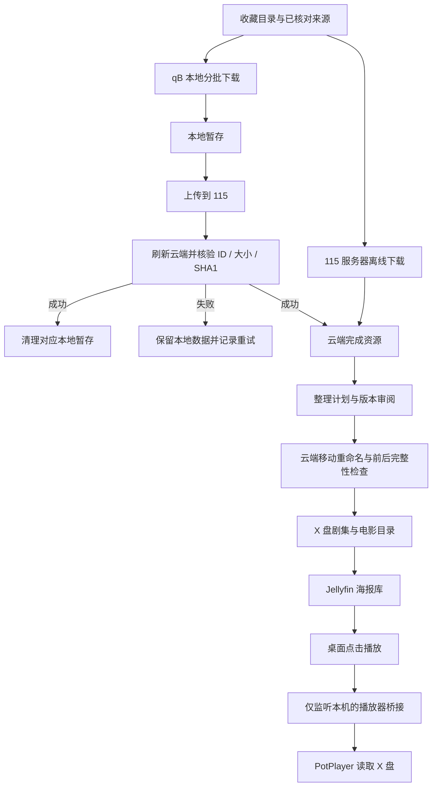

# AnimeLibrary · Windows 动漫影音库

影音保存在 115，Jellyfin 提供海报浏览，Windows 桌面点击播放后交给 PotPlayer。后台负责分批下载、上传、云端核验、整理和报告。

**本地暂存只有在云端文件身份、大小和 SHA1 全部核验通过后才会清理。** 没有做种、季集不明确、字幕版本冲突或上传失败时，保留数据并记录原因。

这是 2026-11-03 至 2026-11-05 的个人部署总结与核心源码归档。运行依赖本机凭据、匹配版本的协议客户端和原始账本；克隆后应先阅读文档、运行离线检查，再准备部署。

## 功能

|模块|做法|
|---|---|
|云端存储|CloudDrive2 挂载 115，以 `X:\动漫` 为媒体根目录|
|收藏目录|Bangumi 日本动画 Top 100，与 2022—2026 年截至采集日已开播的 TV/WEB 条目合并去重|
|云端获取|已有来源交给 115 服务器离线处理，额度不足时持久停止新增提交|
|本地补充|qBittorrent 分批暂存、上传，云端核验后清理对应本地数据|
|整理|剧集/季/集命名、电影拆分、外挂字幕语言与版本区分、资料归档|
|媒体库|Jellyfin Server 的“动画剧集”和“动画电影”两个库|
|播放|Jellyfin 桌面端 → 带令牌的本机桥接 → PotPlayer 读取 X 盘|
|保护|慢源轮换、空间保护、部分文件保留、重复来源防护与可恢复账本|
|异地观看|记录 Tailscale + Jellyfin 已部署入口及 115 直连方案的边界|

## 文档导航

|文档|内容|
|---|---|
|[部署与恢复](docs/setup-and-recovery.md)|组件、运行目录、依赖、凭据与恢复顺序|
|[架构与目录](docs/architecture.md)|两条获取路径、账本与媒体布局|
|[日常操作](docs/operations.md)|启动、打游戏暂停、恢复、额度与异常处理|
|[PotPlayer 接入](docs/player.md)|点击无反应、认证、解码错误、实测与回退|
|[整理与修复](docs/repairs.md)|缺集、字幕、重复版本、跨季与绝对集数|
|[完整工作总结](docs/work-summary.md)|需求演进、所有交付和仍未完成的事项|
|[异地观影](docs/remote-access.md)|朋友接入、依赖本机开机的场景|
|[验证记录](docs/verification.md)|离线回归和实际服务验收的范围|
|[源码归档](archive/README.md)|各文件职责及运行前提|

## 架构与数据流



115 离线任务的影音传输发生在服务器侧。qB 路径会使用本机网络与暂存空间。PotPlayer 从挂载盘播放同样需要本机网络，并可能触发 CloudDrive2 缓存。

## 进展与统计口径

冻结快照：**2026-11-05 10:55:55，Asia/Shanghai**。后台继续工作，新进展以本机最新报告为准。

|指标|数量|
|---|---:|
|目标目录条目|1,594|
|已核验整理资源批次/合集|951|
|集/OVA 文件|7,496|
|电影文件|37|
|外挂字幕文件|2,081|
|整理核对过的原始文件|13,364|
|暂缓条目|0（本轮审阅完成）|

qB 另一时间点的账本（10:57:34）显示累计核验上传约 **1.62 TB** 已选数据，涉及 215 个动画条目。它是累计处理量，可能包含重复版本，不能当作云盘去重后的占用，也不表示这些条目全部齐全。

**条目、任务、分块、资源批次、视频文件、全集完成数分别计数。** 不能用 `1,594 - 951` 推算剩余动画数量。完成任务会在云端核验后移除，因此当前 qB 的“已完成”列表也不代表历史下载量。

机器可读记录：[状态快照](docs/status-snapshot.json)、[11 月 5 日增量](docs/update-20261105.json)。

## 部署准备与恢复

本机记录的组合为 Windows、qBittorrent 5.3.0、Jellyfin Server 12.4.0、Jellyfin Media Player 1.12.0、CloudDrive2 和 PotPlayer。版本是实测环境记录，不代表兼容所有第三方版本。

需要准备：

1. 自己的 115 账号、空间和离线额度，在 CloudDrive2 完成登录及挂载。
2. Python 虚拟环境与依赖。云端查询需要匹配部署版本的 gRPC 客户端和协议文件；生产批处理必须使用依赖齐全的虚拟环境。
3. qB 本机 Web API、独立凭据、专用下载分类与暂存目录。
4. Jellyfin Server、桌面客户端、两个媒体库和可读的 X 盘。
5. 官方 PotPlayer 文件；DTS/TrueHD 等音轨还需检查对应解码组件。
6. 原任务账本、整理账本与配置备份。先恢复账本，再恢复任务提交。

仓库不含账号、令牌、完整生产数据、播放器安装包或生成的 gRPC 文件。`archive/runtime` 是经过脱敏的核心实现，仍包含本次项目专用映射与历史入口，需要阅读后适配。

恢复顺序：先恢复 CloudDrive2 与挂载，确认能读取现有文件；再恢复 qB、Jellyfin、Python 环境和原账本。先做只读查询与一个小批次的上传核验，再启动批量调度。最后接入播放器，分别验证电影、单集与额外音轨解码。

在 MSIX 应用内部署时，要核实真实路径。外部桌面进程不一定继承应用对 LocalAppData 的虚拟视图，启动器应使用验证过的绝对路径。

## 目录和命名

```text
X:\动漫\
├─ 剧集\
│  └─ 动画名称 (年份) [tmdbid-示例]\
│     └─ Season 01\
│        ├─ 动画名称 - S01E01.mkv
│        ├─ 动画名称 - S01E01.zh-Hans.default.ass
│        ├─ 动画名称 - S01E01.zh-Hant.ass
│        └─ 动画名称 - S01E01.zh-Hans.al.ass
├─ 电影\电影名称 (年份)\电影名称 (年份).mkv
├─ 归档\资料\
└─ 待整理\
```

上面是命名示例。备用版本和附加内容保留归档；未知季集映射留待审阅。同名不同内容不能直接覆盖。普通简中轨可标为默认，`.al` 等另一版本保留独立后缀，不再折叠成同一个文件名。

本地运行根目录包含 `batch`、`config`、`player`、`logs` 等。`batch/downloads` 是 qB 暂存，`batch/data` 保存账本；凭据和播放器私密配置独立保留本机。详细布局见部署文档。

## 调度参数与速度

|参数|当前部署值/规则|
|---|---|
|qB 下载并行上限|500（2026-11-05 上午更新）|
|总活动种子 / 上传任务上限|504 / 4|
|全局下载限速回读|`2,147,482,624 B/s`，约 2 GiB/s|
|每秒连接尝试 / 全局连接上限|100 / 3,000|
|Tracker|并行通告资源已有 Tracker，未批量追加陌生地址|
|本地暂存预算 / 空闲保护|160 GiB / 30 GiB|
|分块目标|约 5 GiB；单个视频不能切成独立可整理的几集|
|低速判断|五分钟实际下载字节增量，防止历史均速或协议涓流掩盖慢源|
|重试退避|连续低供数按 30/60/120/240/360 分钟退避，保留部分文件|
|重试顺序|先释放停滞名额，优先有种记录；同作品最多 4 个重试名额，保留 25 个名额给新来源|

500 是上限，实际活动数量受剩余空间、候选来源及退避状态限制。新来源也按作品分散尝试，避免同一作品大量单集占满队列。原有 160 GiB 暂存预算和 30 GiB 空闲保护继续生效。

GB/s、Gb/s、GiB/s 是不同单位。用户曾提出过 3/4 GB/s；本机未把它们误报为已生效值，以上表的回读值为准。

2026-11-05 调整前和稳定后的约两分钟采样，平均速率分别为 5.83、10.16 MiB/s；连接重建期间曾回落到 4.27 MiB/s。这是不同窗口的观察，不能证明某个设置保证翻倍，做种供数、任务完成和网络都会影响结果。

## 日常使用与停止标记

已部署机器有“打开动漫库”“启动批量收藏”“暂停批量收藏”入口。后台使用 `pythonw.exe` 和隐藏子进程，正常工作不应反复弹控制台。

- **观看**：打开动漫库，在 Jellyfin 桌面端选择作品/单集并播放；字幕和音轨在 PotPlayer 中切换。
- **打游戏**：使用暂停入口，允许当前上传核验或整理批次到达一致状态，避免直接杀掉正在写账本的进程。
- **继续**：使用启动入口，保留额度停止锁。启动不会自动再次消耗已用完的云端额度。
- **看进展**：先看报告更新时间，再分别检查下载、待上传核验和整理暂缓。

|标记|作用|
|---|---|
|`STOP`|停止本地批量调度|
|`STOP_CLOUD`|停止新增云端提交|
|`STOP_ORGANIZE`|停止开始新的整理批次|
|`CLOUD_QUOTA_STOP`|115 额度不足后的持久锁|

已提交给 115 的远程任务仍可继续。额度恢复时先核对账号与原账本，再明确恢复提交；不要定时自动删除额度锁。

## PotPlayer 的当前接入

11 月 5 日修复后，通过 `127.0.0.1:18097` 的本机 HTTP 桥接启动，替代依赖 Windows `playbridge` 协议关联的旧路径。URI 解析器继续严格限制媒体路径。

每台机器使用随机令牌，只允许 `X:\动漫` 内视频，参数数组调用固定播放器，不执行 shell。网页请求限定来源；Jellyfin 桌面原生网络层可能省略 Origin，此时仍要求正确令牌。端口独占绑定，避免新旧后台进程同时占用端口、请求落到旧版本。

桥接随本机观影入口按需启动，也配置了当前用户登录后的静默启动。私密 `local-server.json`、绑定设备的最终注入脚本和真实令牌不公开。

已从 Jellyfin 实际点击《幽灵公主》和《无职转生》单集，验证正确文件、播放画面和推进的计时。电影 DTS-HD 报错通过补充播放器本地解码模块解决。**PotPlayer 的进度和已看状态目前不回传 Jellyfin。** [完整接入说明](docs/player.md)。

## 常见问题

### 100 个活动任务为什么仍然慢？

活动名额不等于 100 个远端在供数。本次曾观察到约三分之二活动任务速度为零。先检查实际接收数据的任务、连接与做种、本地磁盘，再判断限速。提高并行或限速无法补出不存在的做种。

### 上传完为什么还留本地？

挂载盘文件出现可能只是缓存或上传中。刷新后的云端文件身份、大小、SHA1 任一步未通过，就保留本地；不能只凭进度 100% 删除。

### 为什么某部不整理？

可能是 TV/未删减双版本、同集 v2、字幕后缀冲突、跨季或绝对集数不明确。此次人工审阅的 9 批资源新增整理 33 集、56 份字幕，核验 151 个原始文件，备用版本保留归档。

### 点击无反应，或打开后报错？

先区分是否唤起：检查桥接健康状态、客户端日志、播放器进程与 X 盘。已经打开后的 DTS 等音轨错误继续检查解码器。桥接端口无需开放给朋友或互联网。

### 朋友能完全绕过我的电脑吗？

Jellyfin/Tailscale 这条路径需要本机在线。朋友使用自己的 115 账号接收内容或部署独立播放器是另外的方案，不能把本机入口说成已实现的无电脑直连。

## 源码与验证

```powershell
python tools/run_checks.py
```

检查器复制仓库到临时目录，解析编译源码，独立运行测试，禁用外部 socket 连接，并将 LocalAppData 指向临时空目录；不会连接真实 qB、115、Jellyfin。

|目录|内容|
|---|---|
|`archive/runtime`|批量调度、云队列、整理、核验及部署入口归档|
|`player`|路径解析、协议注册历史实现、本机 HTTP 桥接|
|`tests`|上传保护、分块、调度、季集映射、字幕与播放器校验|
|`tools`|离线检查和发布扫描|
|`docs`|详细文档、冻结统计、验证与增量记录|

离线通过不代替真实网络和播放器验收，也不表示新机器已安装好依赖。不要用整个生产目录覆盖源码归档。

## 公开范围与限制

仅公开文档、核心脚本、测试和脱敏统计。媒体、字幕内容、种子/磁力清单、账号密码、令牌、会话、邀请、真实异地地址、原始日志、数据库和二进制不发布。来源应限于使用者有权获取的内容，本仓库不提供影音资源索引。

完整列表翻页仍缺少最终修复证据；新来源不能盲目套用既有季集映射；有种但不供数的资源仍可能长期缺集。第三方组件与许可证见 [THIRD_PARTY.md](THIRD_PARTY.md)。
