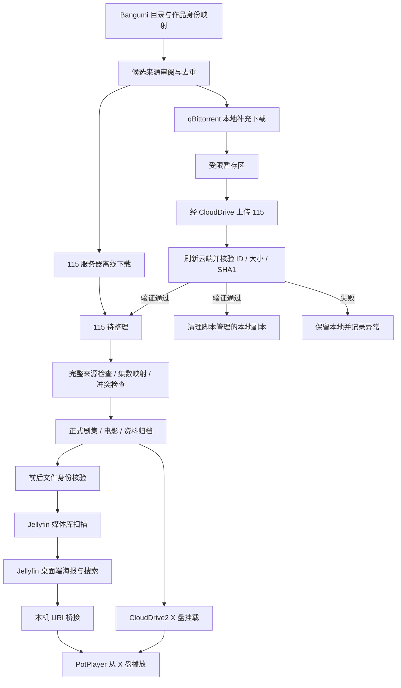

# 架构与目录



## 云端媒体布局

```text
X:\动漫\
  剧集\
    示例动画 (2024) [tmdbid-示例]\
      Season 01\
        示例动画 - S01E01.mkv
        示例动画 - S01E01.zh-Hans.default.ass
  电影\
    示例电影 (2024) [tmdbid-示例]\
      示例电影 (2024).mkv
      示例电影 (2024).zh-Hans.default.srt
  归档\资料\
  待整理\
    云端下载\
    批量收藏\
```

显示名称是方便浏览的标签，身份应以作品映射与来源审核为准；不同季度/合集不能只靠相似中文标题合并。

## 本机运行布局

```text
%LOCALAPPDATA%\AnimeLibrary\
  batch\                    调度脚本
    data\                   私有账本、来源、清单、整理计划
    downloads\              本地暂存，云端核验前不得清理
    generated\              CloudDrive protobuf 客户端
    venv\                   Python 环境
  config\                   DPAPI 加密凭据与服务配置
  data\                     Jellyfin 数据、插件
  cache\                    媒体库缓存
  logs\                     本机日志
  player\
    PotPlayer\              官方播放器运行文件
    bridge\                 本机 URI 处理器
  qbittorrent\              qB 应用
  server\jellyfin\          Jellyfin 应用
```

Codex 桌面应用的 MSIX 文件视图可能把 LocalAppData 重定向到包内 LocalCache。URI 注册时使用 `Path.resolve(strict=True)` 解析实际文件位置，避免外部应用读取到另一个目录视图。

## 服务边界

|本机接口|用途|
|---|---|
|`127.0.0.1:8097`|Jellyfin|
|`127.0.0.1:8098`|qB WebUI|
|`127.0.0.1:29798`|CloudDrive gRPC|

这些是本机基线，不是向互联网公开 API 的说明。远程观看通过单独的 Tailscale HTTPS 入口；其真实域名、IP 和邀请留在本机。

本地任务账本、云队列账本、整理账本和媒体库索引分别承担不同职责。文件在挂载盘中可见，不等于云端已经持久写入；云任务完成，也不等于媒体库已经识别和集数齐全。
